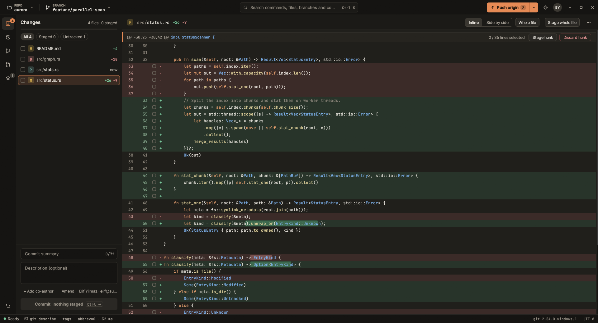
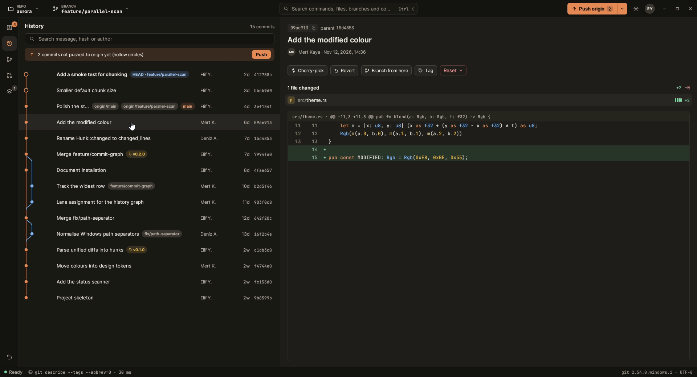
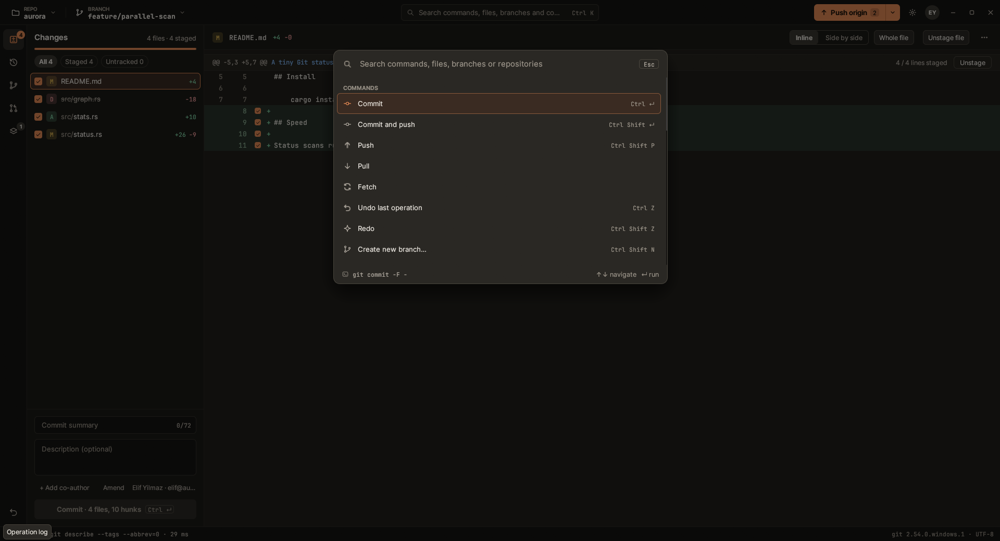
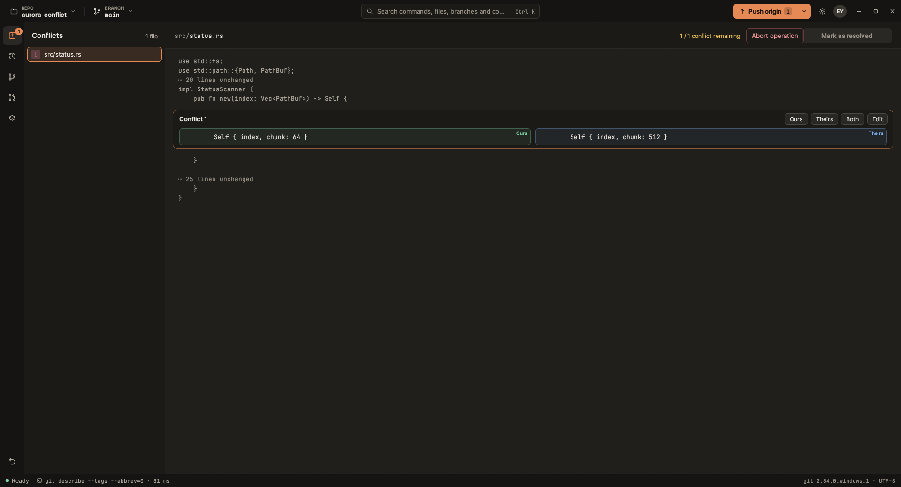
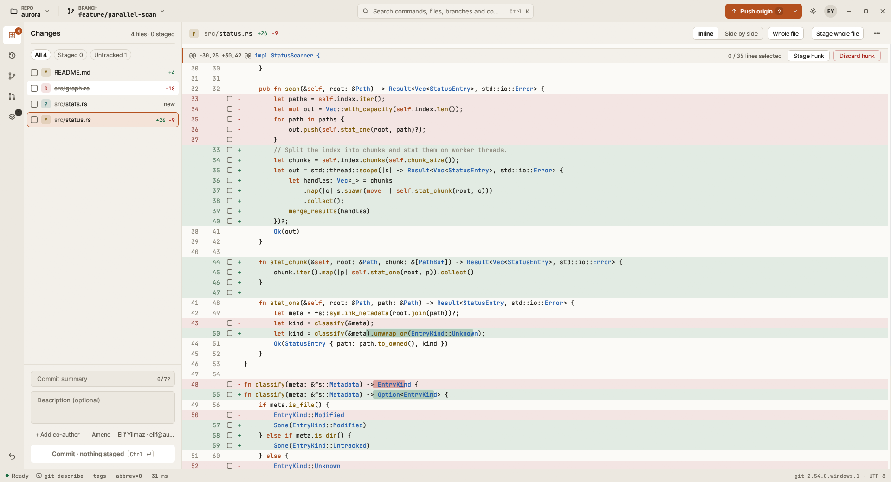
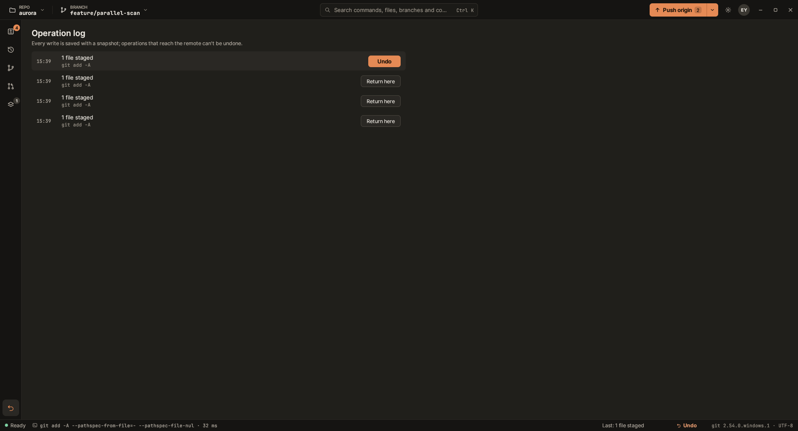

<p align="center"></p>

# Ferro

A native Git client for Windows, written in Rust and drawn entirely by hand with [egui](https://github.com/emilk/egui) — no Electron, no web view.

> Ferro is an independent concept project. It is **not** affiliated with, endorsed by or derived from GitHub, Inc. or GitHub Desktop. "GitHub" is a trademark of GitHub, Inc.

## Screenshots

| | |
|---|---|
|  |  |
|  |  |
|  |  |

*Screenshots use a fictional demo repository.*

## Features

- Hunk and line staging (click, shift-click), side-by-side or inline diff
- Commit graph, history search, cherry-pick / revert / reset / tag / branch from any commit
- Operation log with **Undo / Redo** (Ctrl Z / Ctrl Shift Z) for local operations
- Command palette (Ctrl K) and branch switcher (Ctrl B) with a stash-or-bring-changes prompt
- Branches, stashes, pull requests (GitHub REST), conflict resolver (ours / theirs / both / edit)
- Clone by URL or from your GitHub account; sign in with the browser (OAuth device flow) — no tokens to paste
- Dark / light / system theme, compact mode, UI scale, English and Turkish (auto-detected)
- Every action shows the git command behind it

Ferro shells out to the system `git`; it does not bundle libgit2.

## Build

Requirements: Rust (stable), Git for Windows.

```bash
cargo build --release          # target/release/ferro.exe
```

Optional installer (a small egui program that embeds `ferro.exe`; build Ferro first):

```bash
cd installer-app
cargo build --release          # target/release/ferro-setup.exe
```

## Configuration

| What | Where |
|---|---|
| Settings, recent repositories | `%APPDATA%\Ferro\state.json` |
| GitHub tokens | Windows Credential Manager (never written to disk by Ferro) |
| GitHub sign-in | **Git Credential Manager** (ships with Git for Windows): "Add account" opens the browser sign-in, the account lives in the same store `git` uses. Accounts you already signed in with `git` show up automatically. Ferro has no OAuth app of its own and no client secret. |
| Custom OAuth app (optional) | Set `FERRO_GITHUB_CLIENT_ID` to a client id with *Device Flow* enabled and Ferro uses the device flow instead (scopes `repo workflow`). Client ids are public, not secrets. |

## Project layout

```
src/            app, chrome, screens (changes, history, palette, branches, PR, conflict, settings)
src/backend/    git CLI wrapper, GitHub REST / device flow, staging patches
installer-app/  the installer / uninstaller
promo/          scripts and Remotion project used to make the showcase video (optional)
licenses/       licenses of bundled fonts
```

## Status

Early. Windows only, tested with Git for Windows 2.5x. Performance figures in the showcase video were measured on one machine and will vary.

## License

MIT — see [LICENSE](LICENSE). Bundled fonts (Inter, JetBrains Mono) are under the SIL Open Font License; see [THIRD_PARTY_NOTICES.md](THIRD_PARTY_NOTICES.md).
